# AccioBank — banco digital (projeto de portfólio)

<p align="center">
  
</p>

> **Accio** é o feitiço que chama as coisas até você. O AccioBank chama o seu dinheiro: um banco digital com tema noturno de magia, uma coruja como mascote e as regras de um banco de verdade por baixo.

[](https://github.com/JhonReimberg/accio-bank/actions/workflows/ci.yml)


## Tecnologias

<p>
  
</p>

| Camada | Stack |
| --- | --- |
| Backend | C# · ASP.NET Core 10 (Minimal APIs) · EF Core · SignalR · Hangfire · FluentValidation · Serilog · QuestPDF |
| Banco de dados | PostgreSQL 17 |
| Frontend | React 19 · TypeScript · Vite · React Router · TanStack Query |
| Testes | xUnit · Testcontainers (PostgreSQL real) |
| Infra | Docker Compose · nginx · GitHub Actions |

> **Projeto fictício, feito para portfólio.** "AccioBank" não é uma instituição real e não tem relação com nenhum banco. Os CPFs, chaves e documentos usados são gerados para teste. O projeto começou com o nome "Vela" (por isso os e-mails de demonstração ainda usam esse nome).

Um banco digital com regras de negócio reais: **ledger de partidas dobradas**, **controle de concorrência**, **idempotência**, **PIX** (chaves, QR Code, copia e cola, devolução, agendamento e limites noturnos), **onboarding com KYC**, **2FA**, **senha transacional** e **crédito** (score explicável, motor de elegibilidade, empréstimo pela Tabela Price, cheque especial e back-office), **cartões** (fatura, parcelamento, rotativo), **investimentos** (CDB, caixinhas, IR regressivo), **antifraude**, **boletos** e **notificações em tempo real** (SignalR). As três fases do [roadmap](#roadmap) estão prontas.

| Início no celular | Cofres (Usar · Guardar) | Meus cartões |
| --- | --- | --- |
| 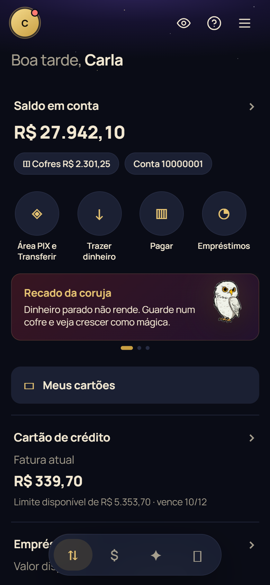 | 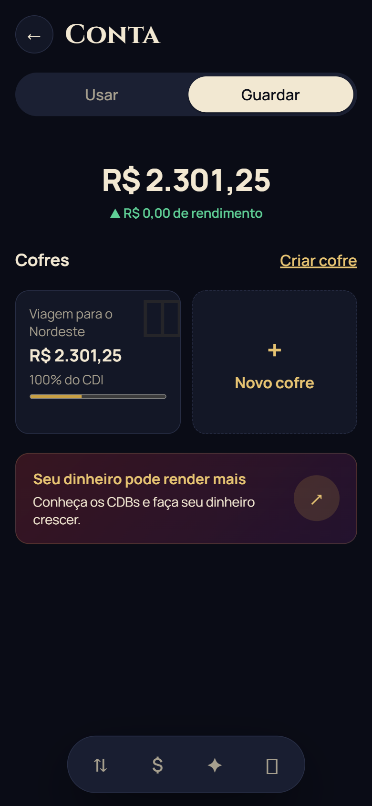 | 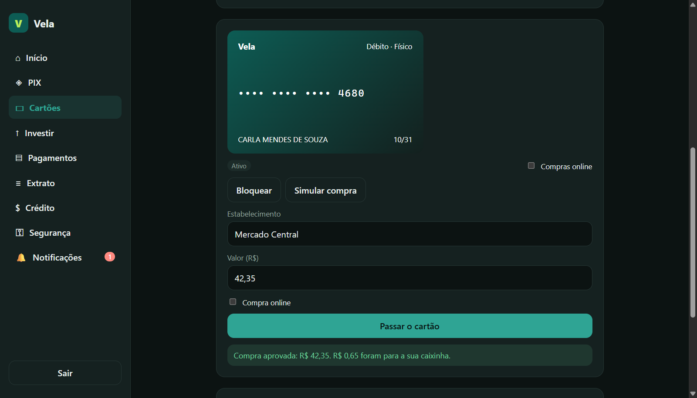 |
| **Investimentos** | **PIX no celular** | **Menu** |
| 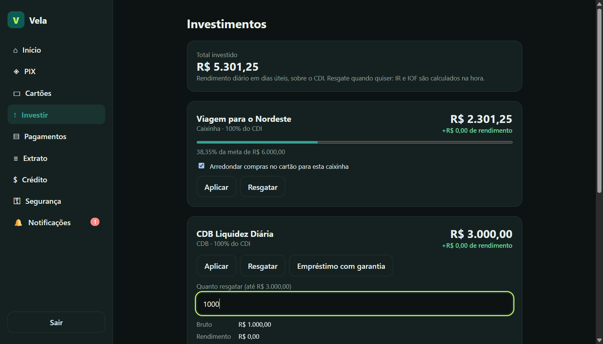 | 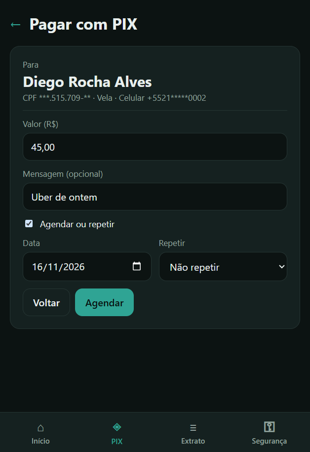 | 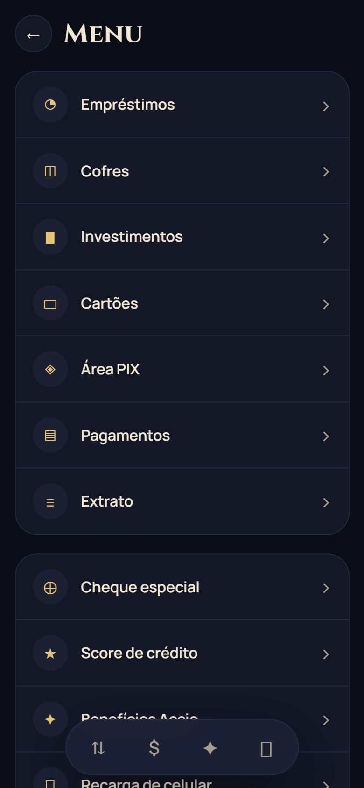 |

| Início (desktop) | Entrar |
| --- | --- |
|  | 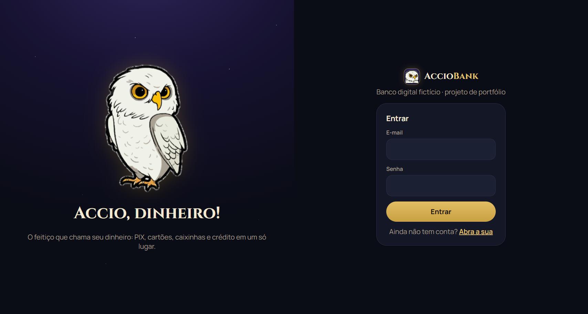 |
| **Empréstimo: o que falta para liberar** | **Notificação em tempo real (SignalR)** |
| 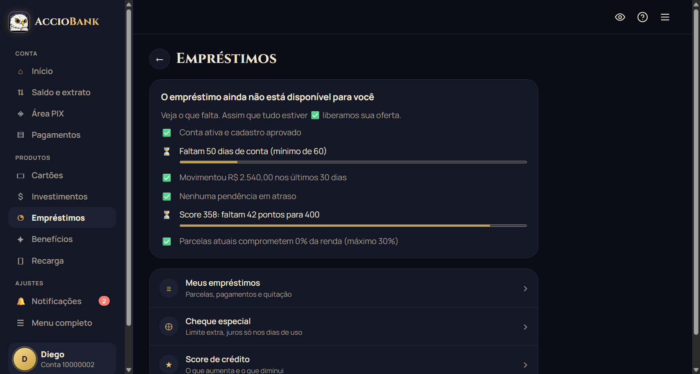 | 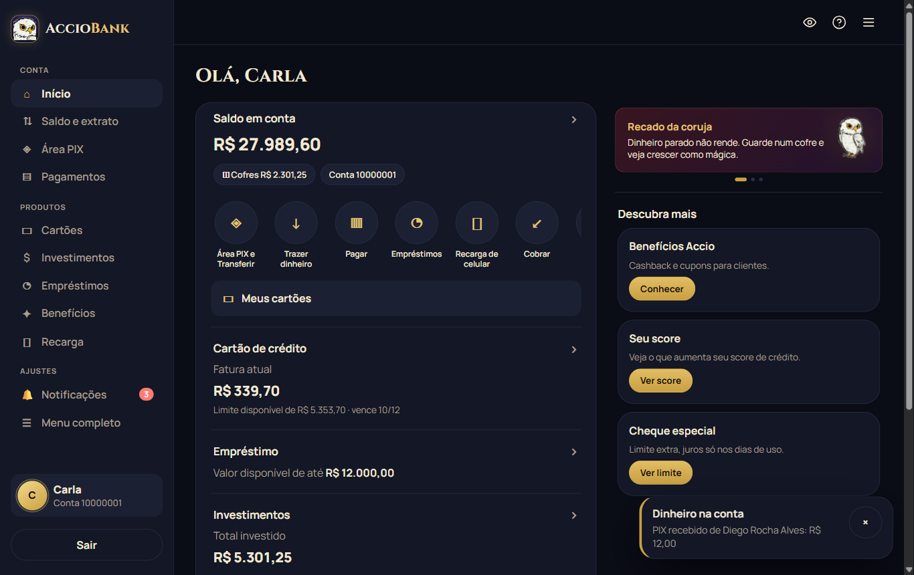 |
| **Simulação de empréstimo (Price, IOF, CET)** | **Fatura do cartão** |
| 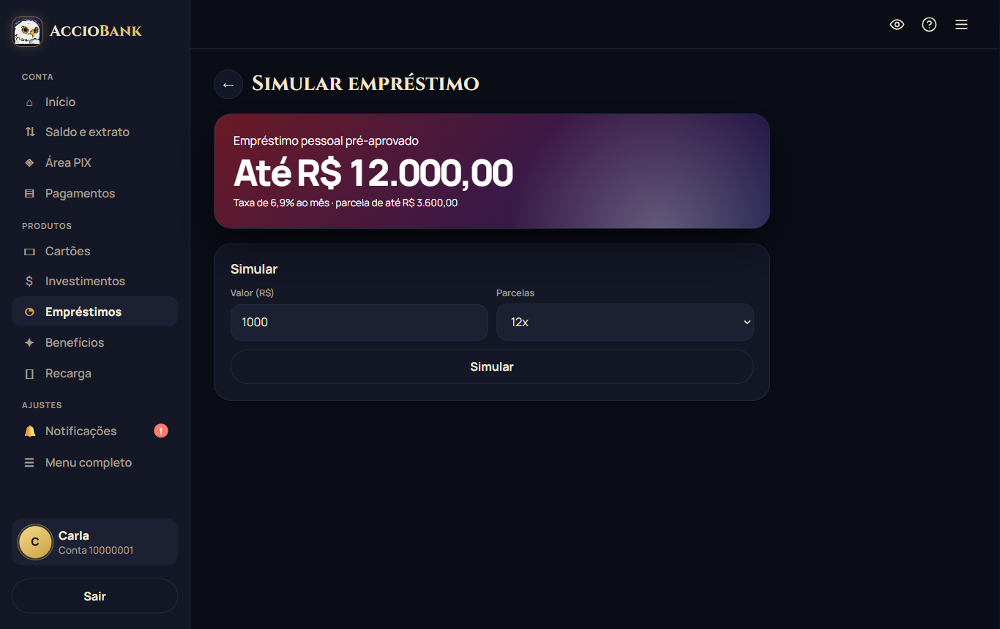 | 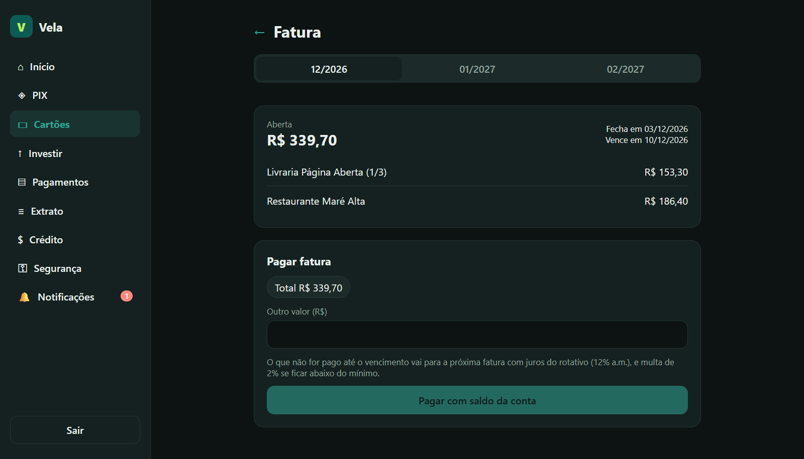 |
| **Receber com QR Code** | **Design system** |
|  | 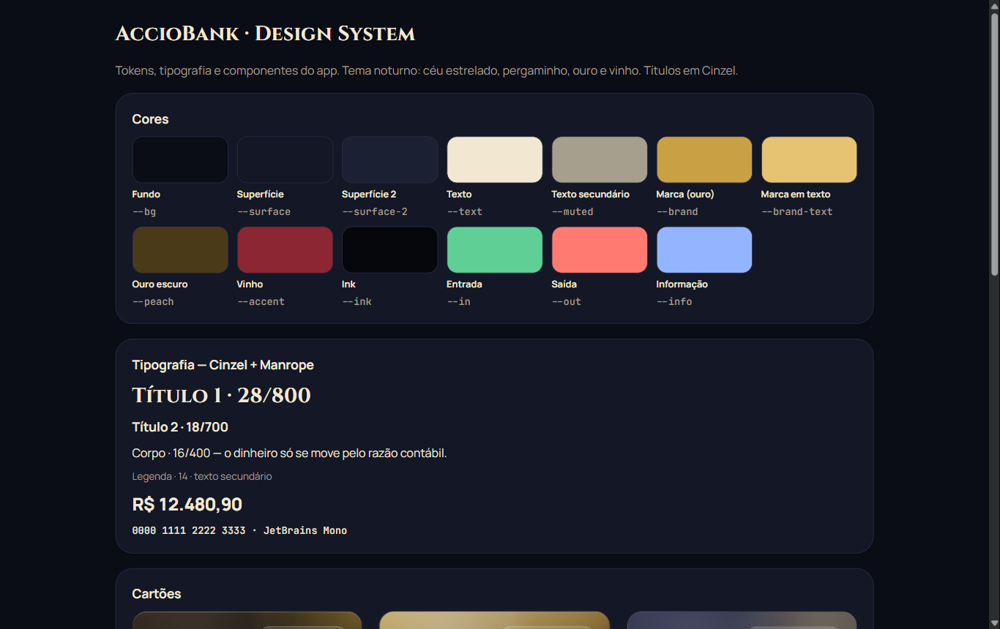 |
| **Back-office: painel** | **Back-office: antifraude** |
| 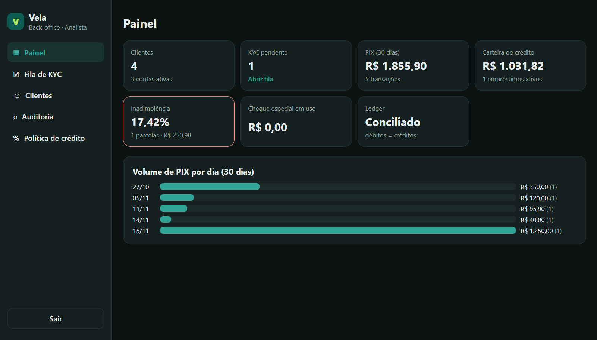 | 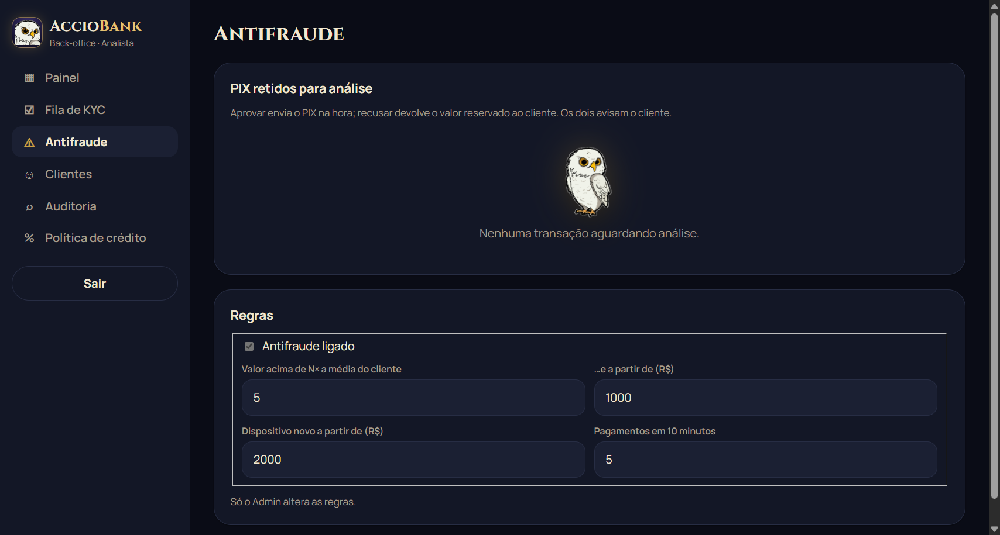 |

## Visual e experiência

- **Tema noturno de magia, sempre escuro:** céu estrelado, texto cor de pergaminho, dourado como cor da marca e vinho para dar profundidade. Títulos em Cinzel (letras de inscrição) e interface em Manrope.
- **Mascote:** uma coruja branca, que aparece no logo, no favicon, no login, nas dicas ("Recado da coruja") e nas telas vazias, com movimentos leves (flutuar, pulinho, inclinar a cabeça).
- **Cartões com cara de 3D:** débito em metal preto, crédito em folha dourada e virtual em vidro, com chip, símbolo de aproximação e um reflexo que acompanha o ponteiro.
- **Celular e desktop diferentes:**
  - no celular, o Início tem uma faixa com avatar, olho para esconder valores, ajuda e menu; ao rolar, ela encolhe e mostra a marca. A navegação fica numa barra flutuante só com ícones (Início, Investimentos, Benefícios, Recarga);
  - no desktop, menu lateral agrupado e o Início em duas colunas.
- **Cada passo no seu lugar:** o Início mostra resumos (saldo, cartão, empréstimo, investimentos, últimas movimentações) e cada um abre a própria tela. Cada área tem uma tela-menu e cada operação uma tela separada: cartões (lista → detalhe → simular compra, pedir cartão, ativar crédito), investimentos (visão geral → produto → aplicar, resgatar, empréstimo com garantia), pagamentos, empréstimos e segurança.
- **Conta com abas Usar e Guardar**, menu completo, perfil, configurações, ajuda com perguntas frequentes e uma área de benefícios (ainda sem programa de vantagens: aparece como "em breve").
- **Foto de perfil:** escolhida no Perfil, recortada em quadrado e salva pela API, então aparece em qualquer aparelho.
- **Design system vivo** em `/design-system` (cores, tipografia, cartões, mascote e componentes), aberto sem login.
- **Acessibilidade:** contraste AA no texto, foco visível, rótulos nos botões só de ícone e animações desligadas para quem pede menos movimento.

## Rodar com um comando

Pré-requisito: Docker.

```bash
cp .env.example .env
docker compose up --build
```

| O quê | Onde |
| --- | --- |
| App | http://localhost:8080 |
| API (documentação Scalar/OpenAPI) | http://localhost:5080/scalar/v1 |
| Jobs (painel do Hangfire) | http://localhost:5080/hangfire |
| PostgreSQL | `localhost:5433` |

### Usuários de demonstração (criados pelo seed)

Senha de todos: `Vela@demo123` · senha transacional: `2580`

| Usuário | Situação |
| --- | --- |
| `carla@vela.dev` | Cliente Plus com 4 meses de conta: **elegível ao crédito**, com caixinha de viagem (recebe o arredondamento das compras), CDB, cartão de crédito com compra parcelada e um boleto emitido |
| `diego@vela.dev` | Conta aberta há 10 dias: **bloqueado por tempo de conta**; tem um PIX de R$ 1.200 **retido pelo antifraude** esperando o analista |
| `eduardo@vela.dev` | Pegou um empréstimo, pagou a 1ª parcela e está com a 2ª **em atraso** (multa + mora) |
| `fernanda@vela.dev` | Cadastro **aguardando análise** na fila de KYC |
| `analista@vela.dev` | Perfil **Analyst** (filas de KYC e antifraude, bloqueios, auditoria) |
| `admin@vela.dev` | Perfil **Admin** (tudo do analista + políticas de crédito e antifraude, conciliação do ledger) |

Também dá para abrir uma conta nova pelo app. No modo demo, a análise de KYC é aprovada automaticamente (`Kyc__AutoApprove`).

## Funcionalidades (Fase 1)

- **Onboarding/KYC em etapas:** dados pessoais com CPF validado pelo dígito verificador, endereço com busca por CEP (ViaCEP), renda e profissão, upload de documento e selfie (validados pelo conteúdo do arquivo) e senha transacional. Status da conta `PendingReview → Active → Blocked → Closed`; níveis `Basic`/`Plus`/`Premium` pela renda.
- **Segurança:** JWT de 15 minutos e refresh token em cookie httpOnly com rotação e revogação. 2FA por TOTP (Google Authenticator), dispositivos confiáveis, alerta de acesso em dispositivo novo, bloqueio temporário após tentativas erradas e histórico de acessos.
- **Conta e extrato:** saldo disponível vs. bloqueado, extrato paginado com filtros (período, tipo, entrada/saída, busca) e comprovante em PDF.
- **PIX:**
  - chaves CPF, e-mail, celular e aleatória (até 5);
  - pagamento por chave ou copia e cola (BR Code com CRC16);
  - QR Code com ou sem valor;
  - devolução total ou parcial;
  - agendado e recorrente (executado por job);
  - limite diurno e noturno: aumento só vale depois de 24 h, redução vale na hora;
  - contatos favoritos.
- **Back-office (API):** fila de KYC, bloqueio de conta e de saldo, log de auditoria pesquisável e relatório de conciliação do ledger.

## Funcionalidades (Fase 2: crédito)

- **Score interno de 0 a 1000**, explicável: cada ponto vem de um fator com nome (tempo de conta, movimentação, renda, parcelas pagas em dia ou com atraso, uso do cheque especial). Ele é recalculado todo dia por job e guarda histórico.
- **Motor de elegibilidade:** em vez de só negar, mostra o que falta (✅/⏳/❌ com barra de progresso). Cada regra é uma classe com testes; os parâmetros são editáveis pelo Admin.
- **Empréstimo pessoal:**
  - oferta pré-aprovada pela faixa de score;
  - simulador com parcela, juros, IOF e CET, e tabela de amortização Price completa;
  - contratação com senha transacional + `Idempotency-Key`, creditada via ledger;
  - débito automático no vencimento, atraso com multa de 2% e mora diária;
  - antecipação com desconto dos juros;
  - contrato em PDF.
- **Cheque especial:** limite pela faixa de score, saldo negativo garantido também por constraint no banco, juros diários cobrados por job (teto de 8% a.m.).
- **Back-office (telas):**
  - painel com volume de PIX, carteira de crédito, inadimplência e status do ledger;
  - fila de KYC com visualização dos documentos;
  - visão 360° do cliente: bloquear e desbloquear, ajustar limite com motivo;
  - log de auditoria pesquisável;
  - política de crédito (taxas por faixa, regras, CDI), com edição restrita ao Admin.

## Funcionalidades (Fase 3: cartões, investimentos, antifraude)

- **Cartões:**
  - débito e crédito com número válido pelo algoritmo de Luhn (BIN fictício);
  - físico, virtual e **virtual temporário** (cancelado sozinho após a primeira compra);
  - bloqueio e desbloqueio, compras online liga/desliga, número completo só com a senha transacional (auditado);
  - limite de crédito pela faixa de score, dia de vencimento escolhido, fatura que fecha 7 dias antes;
  - **compra parcelada** distribuída nas faturas futuras (consome o limite todo na hora);
  - pagamento total, parcial ou mínimo (15%); o restante vai para a próxima fatura com **juros do rotativo** (12% a.m.) e multa de 2% abaixo do mínimo;
  - **simulador de compras** que faz o papel da maquininha/bandeira (recusas ficam registradas com o motivo).
- **Investimentos:**
  - CDB de liquidez diária e **caixinhas com meta** e barra de progresso;
  - rendimento diário em % do CDI (configurado pelo Admin) aplicado por job nos dias úteis;
  - resgate com prévia de **IR regressivo** (22,5% → 15%) e **IOF regressivo** nos primeiros 30 dias, calculados por lote de aplicação (FIFO);
  - **arredondamento** das compras no cartão para a caixinha;
  - **empréstimo com garantia** do CDB: o valor fica bloqueado (e rendendo) e a taxa é menor.
- **Antifraude:** regras configuráveis pelo Admin (valor muito acima da média do cliente, dispositivo novo com valor alto, muitas transações em poucos minutos). PIX suspeito não sai: o valor fica **bloqueado no saldo**, o cliente vê "em análise" e o analista aprova (o PIX é enviado na hora) ou recusa (o dinheiro volta a ficar disponível).
- **Tempo real:** notificações por **SignalR** (PIX recebido, parcela debitada, transação retida, boleto não pago...), com aviso na tela e atualização automática do saldo.
- **Boletos:** emissão para cobrar (linha digitável e código de barras no padrão FEBRABAN, com banco fictício), pagamento validando os dígitos verificadores (módulo 10 e 11) e o fator de vencimento, e **agendamento** até o vencimento.
- **Recarga de celular** simulada (operadoras fictícias), debitada pelo ledger.
- **Foto de perfil:** `PUT/GET/DELETE /api/account/photo`, só JPG ou PNG de até 2 MB, conferidos pelo conteúdo do arquivo, guardados fora do banco e registrados na auditoria.

## Arquitetura

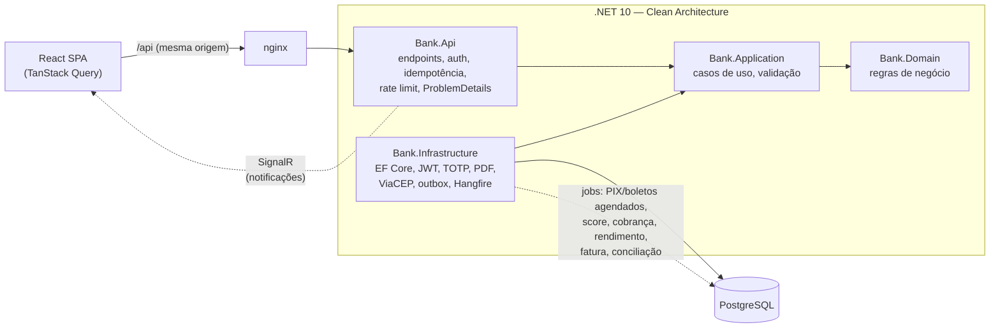

- **Domain:** entidades ricas (`Account`, `LedgerTransaction`, `Customer`, `PixTransfer`, `PixLimitSettings`...) que protegem as próprias regras e lançam `DomainException` com código e mensagem em pt-BR.
- **Application:** um serviço por caso de uso, com validação via FluentValidation. Depende só de abstrações (`IBankDbContext`, `ITokenService`, `IFileStorage`...).
- **Infrastructure:** implementa as abstrações (EF Core/Npgsql, QuestPDF, Otp.NET, QRCoder, ViaCEP, Hangfire) e o processador do outbox.
- **Api:** Minimal APIs, mapeamento de exceções para ProblemDetails (RFC 7807), filtro de idempotência, perfis `Customer`/`Analyst`/`Admin`, rate limiting nativo, Serilog e health checks.

### Modelo de dados (principal)

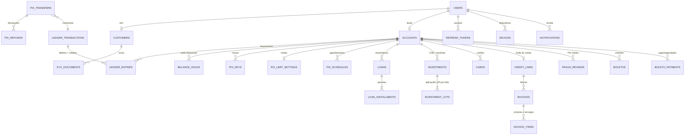

Tabelas de apoio: `audit_logs`, `outbox_messages`, `idempotency_records`, `login_attempts`, `pix_contacts` e as tabelas do Hangfire (schema `hangfire`).

## Decisões técnicas

### Ledger de partidas dobradas
Todo movimento de dinheiro é uma `LedgerTransaction` com lançamentos de débito e crédito (`LedgerEntry`), e a soma dos débitos é sempre igual à dos créditos. Um depósito, por exemplo, debita a conta interna "Caixa" e credita o cliente: dinheiro nunca aparece nem some. O saldo fica materializado na conta para leitura rápida, mas sempre pode ser reconstruído pelo ledger. Um `ReconciliationService` prova isso, e um job diário roda a conciliação. Cada lançamento guarda o saldo após o movimento, o que alimenta o extrato.

### Concorrência
Débitos acontecem com **lock pessimista** (`SELECT ... FOR UPDATE`) dentro de uma transação, travando as contas sempre **em ordem de id** para que A→B e B→A simultâneos não gerem deadlock. Regras que dependem de outras linhas, como "quanto já usei do limite noturno", rodam com a conta travada, então PIX em paralelo não furam o limite. O banco tem `CHECK` constraints como segunda barreira (saldo de cliente ≥ 0, devolvido ≤ valor do PIX).

O mesmo cuidado vale para os contadores de tentativas de senha, 2FA e PIN: a linha do usuário é travada e o contador é gravado antes do erro voltar. Sem isso, 100 palpites em paralelo leriam todos "0 tentativas".

Testes de integração provam:
- 20 débitos simultâneos não deixam o saldo negativo;
- transferências cruzadas não travam o banco;
- PINs errados em paralelo não passam do limite;
- devoluções concorrentes não excedem o valor original.

### Idempotência
PIX, devoluções, agendamentos, transferências e depósitos exigem o header `Idempotency-Key`. A chave é registrada (por usuário) antes da operação. A mesma chave com o mesmo corpo devolve a resposta original sem executar de novo; com outro corpo, a resposta é 422; enquanto a primeira está em andamento, 409. Se a operação falha, a chave é liberada para nova tentativa. O frontend gera uma chave por ação e a reaproveita quando refaz a chamada após renovar o token.

### Outbox
Eventos de domínio ("dinheiro recebido", "acesso em novo dispositivo", "PIX agendado falhou", "KYC aprovado") são gravados na tabela `outbox_messages` **na mesma transação** da mudança: só existem se ela for confirmada. Um processador em background lê com `FOR UPDATE SKIP LOCKED`, por isso pode rodar em várias instâncias, e executa os handlers (notificações no app e e-mail simulado) na mesma transação que marca a mensagem como processada.

### Motor de elegibilidade de crédito
Cada requisito é uma implementação de `IEligibilityRule`: conta ativa, tempo de conta, movimentação em 30 dias, nada em atraso, score mínimo e comprometimento de renda. Cada uma devolve `RuleResult(Code, Passed, Message, Progress)`. As regras compartilham um perfil carregado uma vez por requisição. Os limites vêm da `CreditPolicy`, que o Admin edita no back-office, então mudar "60 dias de conta" para "30" não exige deploy. A oferta (taxa, valor pré-aprovado, limite de cheque especial) depende da **faixa de score**, e o sistema garante que um score maior nunca pague taxa maior.

### Matemática do crédito
- **Tabela Price:** `PMT = PV × i / (1 − (1 + i)^−n)`. Os juros de cada mês são arredondados ao centavo (arredondamento bancário) e a última parcela absorve a diferença, para a soma das amortizações bater exatamente com o valor emprestado.
- **IOF simplificado:** 0,38% fixo mais 0,0082% ao dia sobre a amortização de cada parcela, limitado a 365 dias.
- **CET:** a taxa que iguala o valor efetivamente recebido às parcelas, calculada por bisseção. É mensal e anualizada.
- **Atraso:** multa de 2% (teto do CDC) mais mora diária, aplicadas no pagamento.
- **Antecipação:** desconto pelo valor presente na taxa do contrato, limitado aos juros daquela parcela, para que o principal seja sempre quitado e o ledger continue fechando.
- **Contabilidade:** a contratação é um lançamento em várias pontas (carteira de crédito → cliente + IOF a recolher); a parcela também (cliente → carteira + receitas de crédito).

### Cartões e fatura
Uma compra no crédito não move o saldo do cliente: o banco paga o estabelecimento e passa a ter um valor **a receber** (conta interna de liquidação de cartões). O pagamento da fatura quita esse recebível, e juros/multas do rotativo viram receita. A compra parcelada consome o limite inteiro na hora e gera um item em cada fatura futura (a primeira parcela absorve os centavos do arredondamento). A conta do cliente é travada durante a compra, então duas compras em paralelo não estouram o limite.

### Investimentos
Cada aplicação vira um **lote** com data própria, porque o IR e o IOF dependem do prazo de cada aporte. O resgate consome os lotes do mais antigo para o mais novo (FIFO) e calcula IR/IOF só sobre o rendimento de cada um. O rendimento diário usa a taxa equivalente do CDI em 252 dias úteis.

### Antifraude e boletos
As regras são avaliadas antes de o PIX sair; se alguma dispara, o valor vira um **bloqueio de saldo** e uma análise. Aprovar libera o bloqueio e envia o PIX **na mesma transação**; os limites de PIX são checados quando o cliente pede, não quando o analista aprova. No boleto, um código digitado errado é recusado pelos dígitos verificadores antes de qualquer consulta; o fator de vencimento trata a "virada" de 2025 (voltou a 1000).

### Tempo real
Toda notificação gravada gera um evento no outbox; o handler empurra a mensagem pelo **SignalR** para as sessões abertas do usuário (identificado pelo `sub` do JWT). O WebSocket recebe o token pela query string, só no caminho do hub. A central de notificações continua sendo a fonte da verdade: se o socket cair, nada se perde.

### Outras escolhas
- **Dinheiro em `decimal`** com arredondamento bancário explícito (`MidpointRounding.ToEven`), validado com no máximo 2 casas.
- **Datas em UTC no banco**, regras e exibição no horário de Brasília. O relógio de negócio é um `TimeProvider` injetado, que os testes controlam para simular o período noturno, a carência de 24 h e os agendamentos mensais.
- **Senha transacional** separada da senha de login, exigida em PIX, limites e devoluções; bloqueia por 30 minutos após 3 erros e recusa sequências (1234) e dígitos repetidos.
- **Auditoria** de toda ação sensível (quem, o quê, quando, IP, valores antes e depois em JSON), gravada na mesma transação da ação.
- **Uploads** validados pelos primeiros bytes (assinatura), não pelo nome do arquivo, e guardados fora do banco, com proteção contra path traversal.

## Testes e CI

```bash
cd backend && dotnet test   # 153 unitários + 71 de integração
```

- **Unitários:** regras de domínio, como cálculo de CPF, BR Code e CRC16, períodos e carência de limites, agendamento mensal (31/01 → 28/02 → 31/03), devoluções, bloqueio de PIN, Tabela Price/IOF/CET, IR e IOF regressivos, Luhn, fatura e rotativo, linha digitável de boleto e regras antifraude.
- **Integração:** a API real contra um **PostgreSQL de verdade via Testcontainers**, cobrindo os fluxos de dinheiro, concorrência, idempotência, segurança, KYC, PIX, crédito, cartões, investimentos, antifraude, boletos, foto de perfil e o push via SignalR. Os testes com tempo (rotativo, agendamentos, rendimento) controlam o relógio de negócio, e vários terminam conferindo a conciliação do ledger.
- **GitHub Actions** (`.github/workflows/ci.yml`): build, testes, lint e build do frontend em todo push e PR.

## Desenvolvimento local

Pré-requisitos: .NET SDK 10, Node 24 e Docker.

```bash
docker compose up -d db
cp backend/src/Bank.Api/appsettings.Development.example.json backend/src/Bank.Api/appsettings.Development.json
cd backend && dotnet run --project src/Bank.Api      # http://localhost:5080
cd frontend && npm install && npm run dev            # http://localhost:5173
```

```
backend/
  src/Bank.Domain           regras de negócio (sem dependências)
  src/Bank.Application      casos de uso, validação, abstrações
  src/Bank.Infrastructure   EF Core, migrations, adaptadores, outbox, seed
  src/Bank.Api              endpoints e pipeline HTTP
  tests/                    unitários e integração (Testcontainers)
frontend/src/
  components/               layout, componentes de interface, cartão 3D, mascote
  lib/                      cliente HTTP, sessão, formatação, tipos, foto de perfil
  pages/                    telas (onboarding, início, conta, extrato, PIX, crédito, cartões,
                            investimentos, pagamentos, segurança, menu, back-office)
  index.css                 design system (tokens de cor, tipografia, forma) e estilos
```

## Roadmap

- [x] **Fase 1:** base sólida (conta, segurança, ledger, PIX)
- [x] **Fase 2:** crédito (motor de elegibilidade, score interno, empréstimo pela Tabela Price, cheque especial, back-office)
- [x] **Fase 3:** cartões, investimentos (CDB, caixinhas, IR regressivo), crédito com garantia de investimento, antifraude, notificações em tempo real (SignalR), boletos e recarga
- [x] **Nova identidade:** AccioBank, design system com tema noturno, mascote, navegação no padrão de app de banco e foto de perfil

## Simplificações conscientes

- Todo PIX é entre contas do próprio AccioBank; não há integração com o SPI/DICT reais.
- Chaves de e-mail e celular não são confirmadas por código.
- O e-mail é simulado: as mensagens vão para o log estruturado.
- Boletos de outros bancos e recargas são liquidados contra uma conta interna (não há câmara de compensação nem operadora real).
- O número completo do cartão fica no banco de dados; um emissor real usa um cofre/tokenização no escopo PCI.
- O seed não gera o rendimento retroativo dos investimentos: ele começa a aparecer a partir do primeiro job diário.
- A chave de assinatura dos JWTs e as senhas do `.env` servem só para desenvolvimento.
- A área de benefícios (cashback, cupons, sorteios) e os produtos "Tesouro e ações" são só vitrine: não existem no backend.
- Ao trocar a foto de perfil, o arquivo anterior continua no armazenamento (o serviço de arquivos não tem exclusão).
