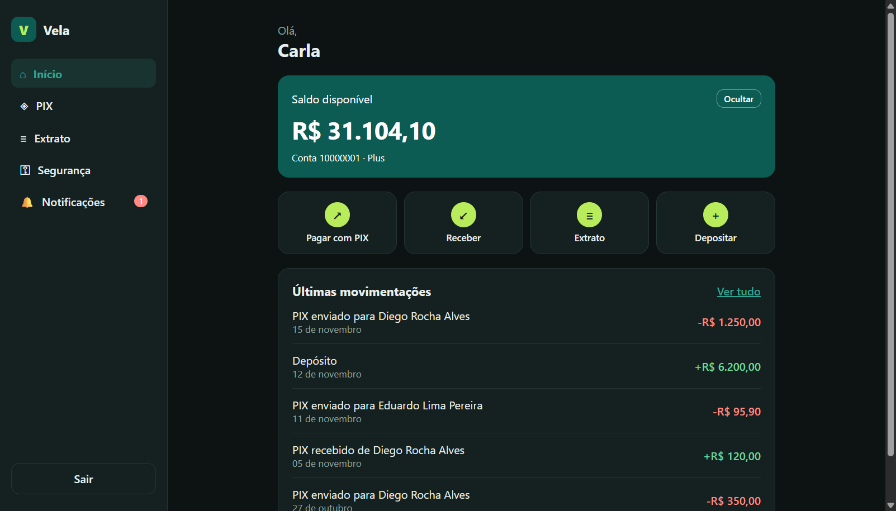
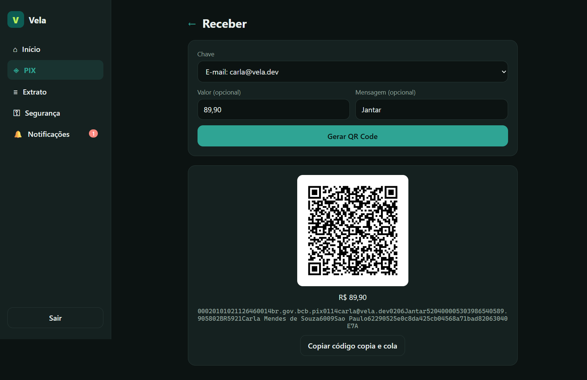
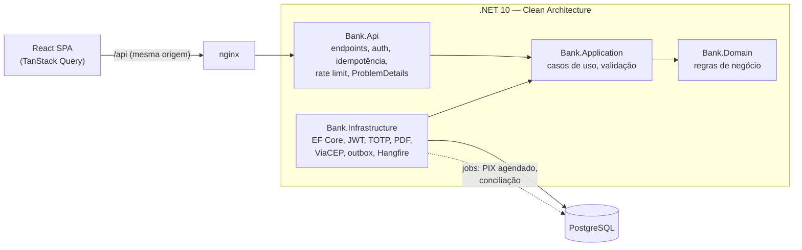
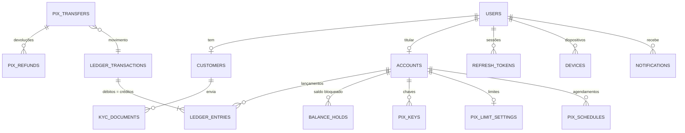

# Vela — banco digital (projeto de portfólio)


> **Projeto fictício, feito para portfólio.** "Vela" não é uma instituição real e não tem relação com nenhum banco. Os CPFs, chaves e documentos usados são gerados para teste.

Um banco digital com regras de negócio reais: **ledger de partidas dobradas**, **controle de concorrência**, **idempotência**, **PIX** (chaves, QR Code, copia e cola, devolução, agendamento e limites noturnos), **onboarding com KYC**, **2FA** e **senha transacional**. A Fase 1 está pronta; crédito e cartões vêm nas próximas fases ([roadmap](#roadmap)).

| Início (desktop) | PIX no celular | Receber com QR Code |
| --- | --- | --- |
|  |  |  |

## Rodar com um comando

Pré-requisito: Docker.

```bash
cp .env.example .env
docker compose up --build
```

| O quê | Onde |
| --- | --- |
| App | http://localhost:8080 |
| API (documentação Scalar/OpenAPI) | http://localhost:5080/scalar/v1 |
| Jobs (painel do Hangfire) | http://localhost:5080/hangfire |
| PostgreSQL | `localhost:5433` |

### Usuários de demonstração (criados pelo seed)

Senha de todos: `Vela@demo123` · senha transacional: `2580`

| Usuário | Situação |
| --- | --- |
| `carla@vela.dev` | Cliente Plus com 4 meses de conta e movimentação recente: será **elegível ao crédito** na Fase 2 |
| `diego@vela.dev` | Conta aberta há 10 dias: será **bloqueado por tempo de conta** no motor de elegibilidade |
| `eduardo@vela.dev` | Conta antiga com saldo baixo: será o **inadimplente** quando o módulo de crédito existir |
| `fernanda@vela.dev` | Cadastro **aguardando análise** na fila de KYC |
| `analista@vela.dev` | Perfil **Analyst** (fila de KYC, bloqueios, auditoria) |
| `admin@vela.dev` | Perfil **Admin** (tudo do analista + conciliação do ledger) |

Também dá para abrir uma conta nova pelo app. No modo demo, a análise de KYC é aprovada automaticamente (`Kyc__AutoApprove`).

## Funcionalidades (Fase 1)

- **Onboarding/KYC em etapas:** dados pessoais com CPF validado pelo dígito verificador, endereço com busca por CEP (ViaCEP), renda e profissão, upload de documento e selfie (validados pelo conteúdo do arquivo) e senha transacional. Status da conta `PendingReview → Active → Blocked → Closed`; níveis `Basic`/`Plus`/`Premium` pela renda.
- **Segurança:** JWT de 15 minutos e refresh token em cookie httpOnly com rotação e revogação. 2FA por TOTP (Google Authenticator), dispositivos confiáveis, alerta de acesso em dispositivo novo, bloqueio temporário após tentativas erradas e histórico de acessos.
- **Conta e extrato:** saldo disponível vs. bloqueado, extrato paginado com filtros (período, tipo, entrada/saída, busca) e comprovante em PDF.
- **PIX:**
  - chaves CPF, e-mail, celular e aleatória (até 5);
  - pagamento por chave ou copia e cola (BR Code com CRC16);
  - QR Code com ou sem valor;
  - devolução total ou parcial;
  - agendado e recorrente (executado por job);
  - limite diurno e noturno: aumento só vale depois de 24 h, redução vale na hora;
  - contatos favoritos.
- **Back-office (API):** fila de KYC, bloqueio de conta e de saldo, log de auditoria pesquisável e relatório de conciliação do ledger. As telas de back-office chegam na Fase 2.

## Arquitetura



- **Domain:** entidades ricas (`Account`, `LedgerTransaction`, `Customer`, `PixTransfer`, `PixLimitSettings`...) que protegem as próprias regras e lançam `DomainException` com código e mensagem em pt-BR.
- **Application:** um serviço por caso de uso, com validação via FluentValidation. Depende só de abstrações (`IBankDbContext`, `ITokenService`, `IFileStorage`...).
- **Infrastructure:** implementa as abstrações (EF Core/Npgsql, QuestPDF, Otp.NET, QRCoder, ViaCEP, Hangfire) e o processador do outbox.
- **Api:** Minimal APIs, mapeamento de exceções para ProblemDetails (RFC 7807), filtro de idempotência, perfis `Customer`/`Analyst`/`Admin`, rate limiting nativo, Serilog e health checks.

### Modelo de dados (principal)



Tabelas de apoio: `audit_logs`, `outbox_messages`, `idempotency_records`, `login_attempts`, `pix_contacts` e as tabelas do Hangfire (schema `hangfire`).

## Decisões técnicas

### Ledger de partidas dobradas
Todo movimento de dinheiro é uma `LedgerTransaction` com lançamentos de débito e crédito (`LedgerEntry`), e a soma dos débitos é sempre igual à dos créditos. Um depósito, por exemplo, debita a conta interna "Caixa" e credita o cliente: dinheiro nunca aparece nem some. O saldo fica materializado na conta para leitura rápida, mas sempre pode ser reconstruído pelo ledger. Um `ReconciliationService` prova isso, e um job diário roda a conciliação. Cada lançamento guarda o saldo após o movimento, o que alimenta o extrato.

### Concorrência
Débitos acontecem com **lock pessimista** (`SELECT ... FOR UPDATE`) dentro de uma transação, travando as contas sempre **em ordem de id** para que A→B e B→A simultâneos não gerem deadlock. Regras que dependem de outras linhas, como "quanto já usei do limite noturno", rodam com a conta travada, então PIX em paralelo não furam o limite. O banco tem `CHECK` constraints como segunda barreira (saldo de cliente ≥ 0, devolvido ≤ valor do PIX).

O mesmo cuidado vale para os contadores de tentativas de senha, 2FA e PIN: a linha do usuário é travada e o contador é gravado antes do erro voltar. Sem isso, 100 palpites em paralelo leriam todos "0 tentativas".

Testes de integração provam:
- 20 débitos simultâneos não deixam o saldo negativo;
- transferências cruzadas não travam o banco;
- PINs errados em paralelo não passam do limite;
- devoluções concorrentes não excedem o valor original.

### Idempotência
PIX, devoluções, agendamentos, transferências e depósitos exigem o header `Idempotency-Key`. A chave é registrada (por usuário) antes da operação. A mesma chave com o mesmo corpo devolve a resposta original sem executar de novo; com outro corpo, a resposta é 422; enquanto a primeira está em andamento, 409. Se a operação falha, a chave é liberada para nova tentativa. O frontend gera uma chave por ação e a reaproveita quando refaz a chamada após renovar o token.

### Outbox
Eventos de domínio ("dinheiro recebido", "acesso em novo dispositivo", "PIX agendado falhou", "KYC aprovado") são gravados na tabela `outbox_messages` **na mesma transação** da mudança: só existem se ela for confirmada. Um processador em background lê com `FOR UPDATE SKIP LOCKED`, por isso pode rodar em várias instâncias, e executa os handlers (notificações no app e e-mail simulado) na mesma transação que marca a mensagem como processada.

### Motor de elegibilidade de crédito
Previsto para a Fase 2: uma lista de regras (`IEligibilityRule`) que mostra ao cliente o que falta, em vez de só negar. O seed já cria clientes nas situações que ele vai avaliar.

### Outras escolhas
- **Dinheiro em `decimal`** com arredondamento bancário explícito (`MidpointRounding.ToEven`), validado com no máximo 2 casas.
- **Datas em UTC no banco**, regras e exibição no horário de Brasília. O relógio de negócio é um `TimeProvider` injetado, que os testes controlam para simular o período noturno, a carência de 24 h e os agendamentos mensais.
- **Senha transacional** separada da senha de login, exigida em PIX, limites e devoluções; bloqueia por 30 minutos após 3 erros e recusa sequências (1234) e dígitos repetidos.
- **Auditoria** de toda ação sensível (quem, o quê, quando, IP, valores antes e depois em JSON), gravada na mesma transação da ação.
- **Uploads** validados pelos primeiros bytes (assinatura), não pelo nome do arquivo, e guardados fora do banco, com proteção contra path traversal.

## Testes e CI

```bash
cd backend && dotnet test   # 93 unitários + 52 de integração
```

- **Unitários:** regras de domínio, como cálculo de CPF, BR Code e CRC16, períodos e carência de limites, agendamento mensal (31/01 → 28/02 → 31/03), devoluções e bloqueio de PIN.
- **Integração:** a API real contra um **PostgreSQL de verdade via Testcontainers**, cobrindo os fluxos de dinheiro, concorrência, idempotência, segurança, KYC e PIX.
- **GitHub Actions** (`.github/workflows/ci.yml`): build, testes, lint e build do frontend em todo push e PR.

## Desenvolvimento local

Pré-requisitos: .NET SDK 10, Node 24 e Docker.

```bash
docker compose up -d db
cp backend/src/Bank.Api/appsettings.Development.example.json backend/src/Bank.Api/appsettings.Development.json
cd backend && dotnet run --project src/Bank.Api      # http://localhost:5080
cd frontend && npm install && npm run dev            # http://localhost:5173
```

```
backend/
  src/Bank.Domain           regras de negócio (sem dependências)
  src/Bank.Application      casos de uso, validação, abstrações
  src/Bank.Infrastructure   EF Core, migrations, adaptadores, outbox, seed
  src/Bank.Api              endpoints e pipeline HTTP
  tests/                    unitários e integração (Testcontainers)
frontend/src/
  lib/                      cliente HTTP, sessão, formatação, tipos
  pages/                    telas (onboarding, início, extrato, PIX, segurança)
```

## Roadmap

- [x] **Fase 1:** base sólida (conta, segurança, ledger, PIX)
- [ ] **Fase 2:** crédito (motor de elegibilidade, score interno, empréstimo pela Tabela Price, cheque especial, back-office)
- [ ] **Fase 3:** cartões, investimentos (CDB, caixinhas, IR regressivo), antifraude e notificações em tempo real (SignalR)

## Simplificações conscientes

- Todo PIX é entre contas do próprio Vela; não há integração com o SPI/DICT reais.
- Chaves de e-mail e celular não são confirmadas por código.
- O e-mail é simulado: as mensagens vão para o log estruturado.
- A chave de assinatura dos JWTs e as senhas do `.env` servem só para desenvolvimento.
